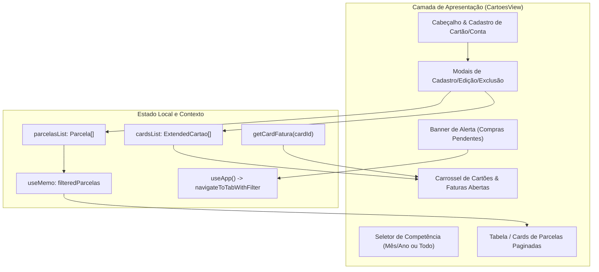
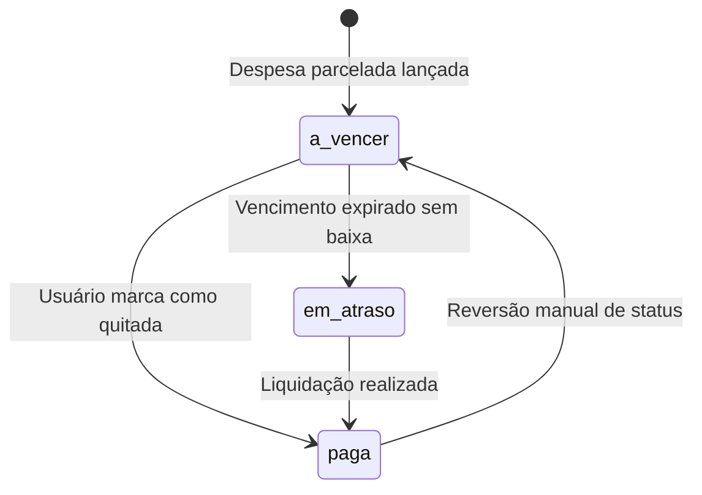

# Unit: Gestão de Cartões e Contas (cartoes) — Design de Arquitetura e Componente

> Especificação Técnica e Comportamental do Módulo de Cartões, Faturas e Parcelas.

## Arquitetura do Componente
O módulo `CartoesView` atua como um hub financeiro de pagamentos a prazo e contas da obra. Integra os cartões físicos com os lançamentos de parcelas vinculadas a despesas.



## Estrutura de Dados e Tipos

```typescript
// Extensão local de CartaoConta
interface ExtendedCartao extends CartaoConta {
  isConta?: boolean;
  banco?: string;
  tipoChave?: string;
  chavePix?: string;
  agenciaConta?: string;
  obraVinculada?: string;
}

// Parcela Canônica
interface Parcela {
  id: string;
  despesaId: string;
  descricao: string;
  cartaoId?: string;
  numeroParcela: number;
  totalParcelas: number;
  valorParcela: number;
  dataVencimento: string; // YYYY-MM-DD
  status: 'a_vencer' | 'paga' | 'em_atraso';
  dataPagamento?: string;
}
```

## Regras de Cálculo e Derivação de Estado

1. **Total a Vencer:**
   $$\sum \text{valorParcela} \quad \forall p \in \text{parcelasList} \mid \text{status} \in \{\text{'a\_vencer'}, \text{'em\_atraso'}\}$$

2. **Total Quitado:**
   $$\sum \text{valorParcela} \quad \forall p \in \text{parcelasList} \mid \text{status} = \text{'paga'}$$

3. **Fatura por Cartão:**
   Filtrada especificamente pelo identificador do cartão e pelo status de débito pendente.

## Máquina de Estados da Parcela



## Interação e Modais

- **Modal de Cadastro:** Alternância dinâmica entre formulário de Cartão de Crédito (bandeira, últimos dígitos, dia fechamento/vencimento) e Conta Bancária (banco, tipo de chave, chave PIX, agência).
- **Modal de Edição de Parcela:** Permite alterar valor, vencimento, descrição, cartão vinculado e quitação imediata.
- **Exclusão Segura:** Modais de confirmação específicos tanto para cancelamento de cartões quanto para exclusão de parcelas.

