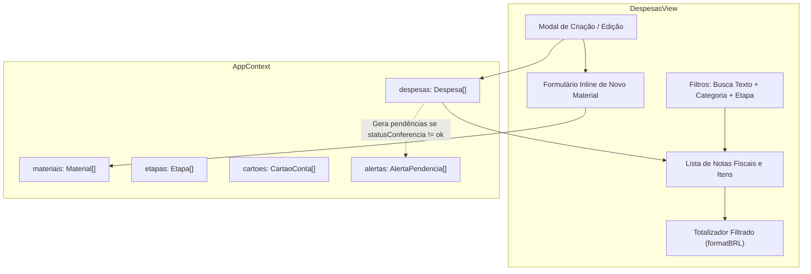

# Unit: Gestão de Despesas e Rateio de Notas (despesas) — Design de Arquitetura e Componente

> Especificação Técnica da Gestão de Compras e Rateios.

## Arquitetura do Componente
O componente `DespesasView` é um dos nós centrais da aplicação, consumindo e alimentando diversos catálogos e submódulos através do `AppContext`.



## Modelo de Entidades e Relacionamentos

```typescript
export interface ItemDespesa {
  id: string;
  materialId: string;
  materialNome: string;
  quantidade: number;
  unidade: string;
  valorUnitario: number;
  valorTotal: number;
  etapaId: string;
  destino: DestinoItem; // 'obra' | 'producao_trilhos' | 'outra_obra' | 'estoque_geral'
  observacoes?: string;
}

export interface Despesa {
  id: string;
  obraId: string;
  descricao: string;
  data: string; // YYYY-MM-DD
  categoria: CategoriaDespesa;
  fornecedorNome: string;
  etapaId: string;
  compradorNome: string;
  formaPagamento: FormaPagamento;
  cartaoId?: string;
  parcelasTotal?: number;
  valorTotalNota: number;
  valorSomaItens: number;
  diferencaRateio: number;
  itens: ItemDespesa[];
  comprovanteUrl?: string;
  statusConferencia: 'ok' | 'pendente_info' | 'diferenca_rateio';
  observacoes?: string;
  criadoPor: string;
  criadoEm: string;
}
```

## Regras de Conferência e Validação

```
1. somaItens = sum(item.valorTotal)
2. valorTotalCalculado = valorTotalNotaNum > 0 ? valorTotalNotaNum : somaItens
3. diferencaRateio = valorTotalCalculado - somaItens
4. statusConferencia = abs(diferencaRateio) > 0.05 ? 'diferenca_rateio' : 'ok'
```

## Fluxo de Cadastro Inline de Material
1. Usuário clica em "+ Cadastrar Material Novo" dentro do modal de despesa.
2. Informa nome e unidade padrão sem sair do fluxo de lançamento.
3. Função `handleSaveNovoMaterial()` invoca `addMaterial()` no contexto global.
4. O novo material é imediatamente atribuído à linha de item ativa.

