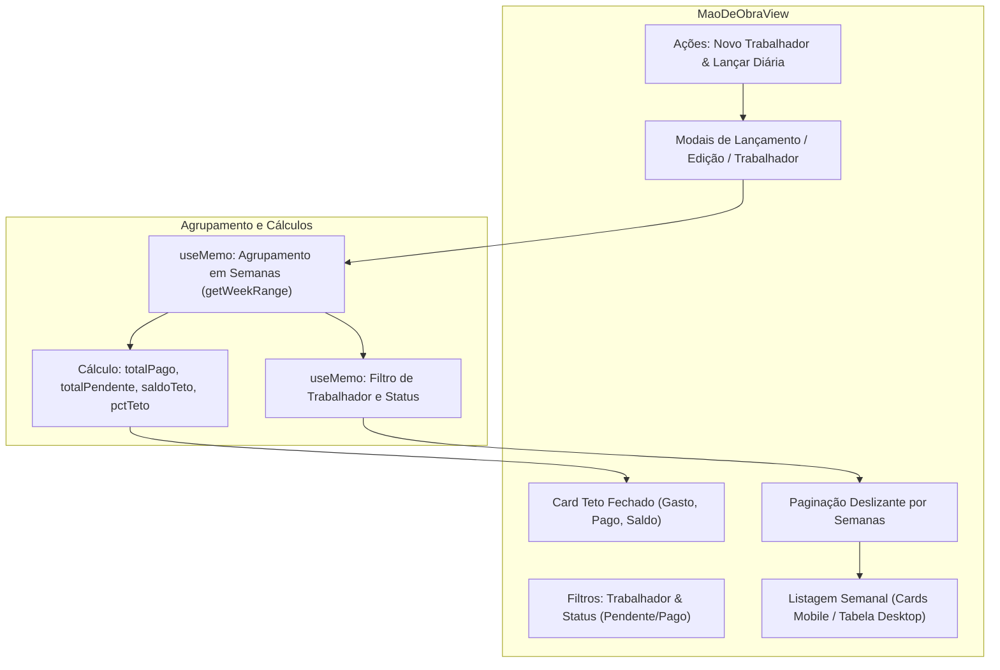

# Unit: Gestão de Mão de Obra e Diárias (maodeobra) — Design de Arquitetura e Componente

> Especificação Técnica do Controle de Diárias e Teto de Mão de Obra.

## Arquitetura do Componente
O módulo `MaoDeObraView` processa os registros cronológicos de diárias, agregando-os por semanas e computando métricas orçamentárias contra o teto fixado da obra.



## Estrutura de Dados e Tipos

```typescript
export interface Trabalhador {
  id: string;
  nome: string;
  funcao: string;
  cpf?: string;
  telefone?: string;
  chavePix?: string;
  valorDiariaPadrao: number;
  ativo: boolean;
  dataAdmissao: string;
}

export interface Diaria {
  id: string;
  obraId: string;
  trabalhadorId: string;
  trabalhadorNome: string;
  data: string; // YYYY-MM-DD
  fracao: number; // 0.5 | 1.0 | 1.5
  valorDiariaBase: number;
  valorCalculado: number; // fracao * valorDiariaBase
  valorAdicional: number;
  descricaoAdicional?: string;
  justificativaAjuste?: string;
  valorTotal: number; // valorCalculado + valorAdicional
  etapaId: string;
  statusPagamento: 'pendente' | 'pago';
  dataPagamento?: string;
  reciboId?: string;
  comprovanteUrl?: string;
  criadoPor: string;
}
```

## Algoritmo de Paginação Sliding Window
Para acomodar grandes quantidades de semanas sem sobrecarregar a barra de navegação, a interface calcula dinamicamente uma janela de até 5 botões de semanas visíveis centradas na semana selecionada:

$$\text{start} = \max(1, \text{currentPage} - \lfloor \text{maxVisible} / 2 \rfloor)$$
$$\text{end} = \min(\text{totalPages}, \text{start} + \text{maxVisible} - 1)$$

Exibindo reticências (`···`) nas extremidades quando há mais páginas anteriores ou posteriores.

