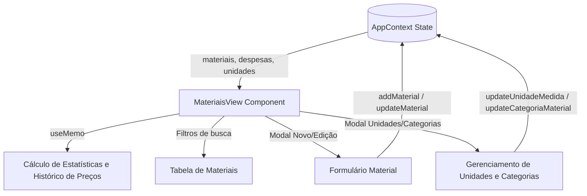

# Design de Arquitetura: Módulo Materiais

> Módulo: `materiais`  
> Componente Principal: `src/components/materiais/MateriaisView.tsx`  
> Contexto: `src/context/AppContext.tsx`  
> Status: 🟢 CONFIRMADO

---

## 1. Arquitetura e Fluxo de Dados

O módulo opera consumindo o estado compartilhado exposto pelo `AppContext`:

- `materiais: Material[]`
- `unidadesMedida: string[]`
- `categoriasMateriais: string[]`
- `despesas: Despesa[]` (para agregação de histórico e estatísticas de compras)



---

## 2. Entidades e Modelos de Dados

```typescript
export interface Material {
  id: string;
  nome: string;
  unidadePadrao: string;
  categoriaSugerida?: string;
  dataCadastro?: string;
}
```

---

## 3. Regras de Negócio e Cálculos

1. **Agregação de Compras**:
   - Para cada material, o componente varre todos os `itens` de todas as `despesas`.
   - Se `item.materialId === m.id` ou `item.materialNome.toLowerCase() === m.nome.toLowerCase()`, o item é computado.
   - São calculados: `totalQuantidade`, `totalGasto`, `precoMedio = totalGasto / totalQuantidade`, `menorPreco`, `maiorPreco`, `ultimoPreco` e histórico ordenado por data decrescente.
2. **Atualização em Cascata de Unidades/Categorias**:
   - Ao alterar o nome de uma unidade de medida ou categoria, o contexto propaga o novo nome para todos os materiais cadastrados que referenciam o valor antigo.
3. **Exclusão Segura**:
   - Permite exclusão de materiais via modal de confirmação.

