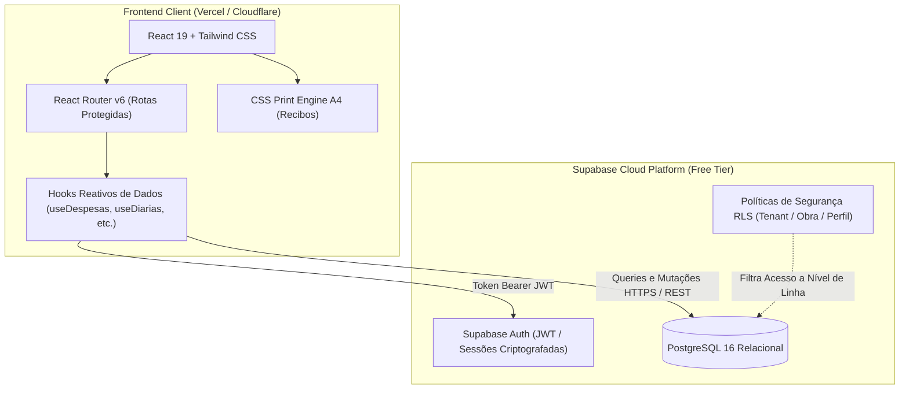

# Target Architecture — SISTEMA LIBRA - OBRAS

> Especificação de arquitetura do sistema modernizado em produção.

---

## 1. Visão Geral da Arquitetura
O sistema é estruturado como uma Single Page Application (SPA) reativa construída com React 19, TypeScript e Vite, servida globalmente via CDN (Vercel ou Cloudflare Pages). Toda a persistência, integridade referencial ACID, autenticação segura e autorização baseada em Row-Level Security (RLS) são delegadas ao Supabase (PostgreSQL 16 Gerenciado).



---

## 2. Bounded Contexts e Estrutura de Pastas (Honra à Topologia)

Materializando a topologia **Feature-Sliced Modular**:

```text
src/
├── core/
│   ├── api/supabaseClient.ts       # Inicialização do Supabase JS Client
│   ├── auth/AuthContext.tsx        # Contexto de autenticação e sessão JWT
│   ├── components/                 # Componentes de UI genéricos (Button, Modal, Toast)
│   └── layout/AppLayout.tsx        # Shell de navegação lateral e cabeçalho
├── features/
│   ├── auth/                       # Login, Perfil e Logout
│   ├── obras/                      # Cadastro de Obras e ObraContext (Obra Ativa)
│   ├── financeiro/                 # Despesas, Cartões de Crédito, Rateio
│   ├── maodeobra/                  # Trabalhadores, Diárias e Impressão A4 de Recibos
│   ├── suprimentos/                # Materiais, Controle de Estoque e Orçamentos
│   ├── engenharia/                 # Produção de Obra, Apontamentos Diários e Metas
│   └── relatorios/                 # Dashboards, KPIs consolidados e Alertas
└── types/                          # Interfaces TypeScript tipadas do Supabase
```

---

## 3. Honra ao Paradigma Escolhido (Transformacional)
- **Assincronicidade e Mutabilidade Segura**: Eliminação total do `AppContext` síncrono. As mutações utilizam chamadas assíncronas com feedback imediato via componentes de Toast/Notificação.
- **Autenticação Real**: Login via `supabase.auth.signInWithPassword()` com tokens JWT persistidos em LocalStorage seguro.
- **Segurança Declarativa (RLS)**: Os dados financeiros de uma obra só são visíveis e alteráveis por usuários com permissão explícita vinculada àquela obra.

