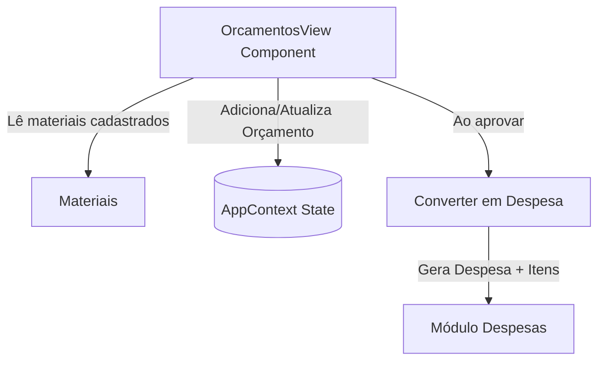

# Design de Arquitetura: Módulo Orçamentos

> Módulo: `orcamentos`  
> Componente Principal: `src/components/orcamentos/OrcamentosView.tsx`  
> Contexto: `src/context/AppContext.tsx`  
> Status: 🟢 CONFIRMADO

---

## 1. Arquitetura e Fluxo de Dados

O módulo gerencia cotações e propostas comerciais integrando o catálogo de materiais e alimentando o módulo de despesas.



---

## 2. Modelos de Dados e Entidades

```typescript
export interface ItemOrcamento {
  id: string;
  materialId?: string;
  materialNome: string;
  quantidade: number;
  unidade: string;
  precoUnitarioCotado: number;
  valorTotalCotado: number;
}

export interface Orcamento {
  id: string;
  obraId?: string;
  num: string;
  empresa: string;
  ident: string;
  data: string;
  etapa?: string;
  status: 'cotacao' | 'aprovado' | 'recusado';
  total: number;
  temFrete?: boolean;
  valorFrete?: number;
  prazoFrete?: string;
  condicoes: string;
  obs?: string;
  itens: ItemOrcamento[];
}
```

---

## 3. Regras de Negócio e Cálculos

1. **Cálculo de Subtotais**: `item.valorTotalCotado = item.quantidade * item.precoUnitarioCotado`.
2. **Total do Orçamento**: Soma de todos os subtotais dos itens adicionado do `valorFrete` (se houver).
3. **Conversão em Despesa**:
   - Cria nova `Despesa` no `AppContext` com:
     - `descricao`: Referência ao fornecedor e número do orçamento
     - `fornecedorNome`: Empresa cotada
     - `valorTotal`: Total do orçamento
     - `itens`: Mapeados diretamente a partir dos itens do orçamento

