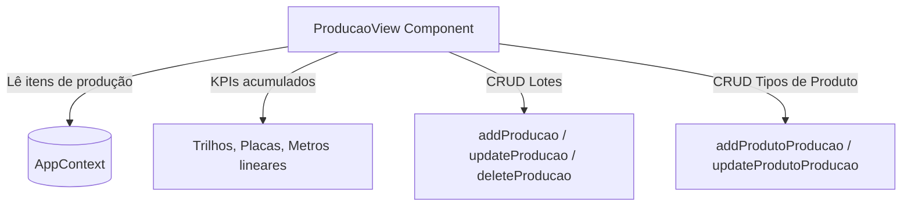

# Design de Arquitetura: Módulo Produção

> Módulo: `producao`  
> Componente Principal: `src/components/producao/ProducaoView.tsx`  
> Contexto: `src/context/AppContext.tsx`  
> Status: 🟢 CONFIRMADO

---

## 1. Arquitetura e Modelagem

O módulo opera de forma autônoma registrando a manufatura interna de materiais pré-moldados.



---

## 2. Entidades de Dados

```typescript
export interface ProducaoItem {
  id: string;
  obraId?: string;
  produto: string; // 'trilho', 'placa_cimento', ou nome customizado
  quantidade: number;
  comprimentoMetros?: number | string;
  especificacao?: string;
  data: string;
  destino?: string;
  observacoes?: string;
}
```

---

## 3. Cálculos e Regras de Negócio

1. **Total de Metros Batidos**:
   - Para itens do tipo trilho: $\sum (\text{quantidade} \times \text{comprimentoMetros})$.
2. **Contagem de Unidades**:
   - Total de trilhos: soma da quantidade de todos os registros de trilhos.
   - Total de placas: soma da quantidade de todos os registros de placas de concreto.
3. **Gerenciamento de Produtos Customizados**:
   - Suporte a artefatos variados (mourões, pingadeiras, blocos) mantidos dinamicamente na lista `produtosProducao`.

