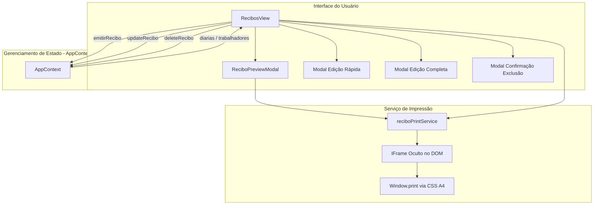

# Design — Módulo `recibos`

> Especificação arquitetural, fluxos de dados, componentes e contratos internos do módulo de recibos.
> Documento gerado automaticamente pelo **Reversa Writer**.

---

## 1. Visão Arquitetural

O módulo `recibos` é o responsável pelo fechamento financeiro operacional da mão de obra. Ele faz a ponte entre o registro de trabalho diário (`Diaria`) e o comprovante físico/digital de quitação (`ReciboPagamento`).



---

## 2. Entidade Principal: `ReciboPagamento`

```typescript
interface ReciboPagamento {
  id: string;
  obraId: string;
  numeroRecibo: string;          // Ex: "REC-2026-001"
  trabalhadorId?: string;        // Opcional se for inserido avulso
  trabalhadorNome: string;
  trabalhadorCpf: string;
  trabalhadorFuncao: string;
  diariasIds: string[];          // IDs das diárias liquidadas neste recibo
  periodoInicio: string;         // YYYY-MM-DD
  periodoFim: string;            // YYYY-MM-DD
  dataEmissao: string;           // YYYY-MM-DD
  valorTotal: number;
  valorPorExtenso: string;
  motivo: string;
  responsavelNome: string;
  localCidade: string;
  observacoes?: string;
  createdAt: string;
}
```

---

## 3. Fluxos Operacionais

### 3.1 Fluxo de Emissão de Recibo
1. O usuário filtra as diárias em aberto (ou por trabalhador específico).
2. O usuário seleciona os dias trabalhados a serem quitados.
3. O sistema calcula a soma dos valores (`totalReciboCalculado`) e intervalo de datas (`periodoInicio` a `periodoFim`).
4. Ao clicar em **Emitir Recibo**:
   - Gera ID único e número de recibo sugerido ou customizado.
   - Converte o valor numérico em extenso via `valorPorExtenso()`.
   - Se `marcarComoPagas === true`, atualiza todas as diárias selecionadas para `statusPagamento: 'pago'`.
   - Adiciona o recibo ao array global `recibos` e define o recibo gerado como `previewRecibo`.

### 3.2 Fluxo de Impressão A4 2 Vias
1. O usuário aciona **Imprimir** diretamente da tela ou através do `ReciboPreviewModal`.
2. A função `triggerReciboInPagePrint` cria dinamicamente um `<iframe>` invisível no documento.
3. O serviço injeta a folha A4 com o HTML contendo:
   - **1ª Via:** Via do Pagador / Contabilidade (topo da página A4).
   - **Linha de Corte:** Linha tracejada horizontal indicativa para corte com tesoura no canteiro de obras.
   - **2ª Via:** Via do Recebedor / Trabalhador (base da página A4).
4. O CSS define `@page { size: A4 portrait; margin: 8mm; }`, garantindo que ambas as vias caibam estritamente em uma única página impressa.
5. O `window.print()` do iframe é acionado e o elemento temporário é descartado.

### 3.3 Fluxo de Exclusão e Estorno
1. Usuário clica em excluir no histórico de recibos.
2. Modal solicita confirmação e apresenta checkbox: `"Restaurar diárias vinculadas para 'pendente'"`.
3. Se marcado, o `deleteRecibo` localiza as diárias listadas em `recibo.diariasIds` e reverte `statusPagamento = 'pendente'`.
4. O recibo é removido do armazenamento.

