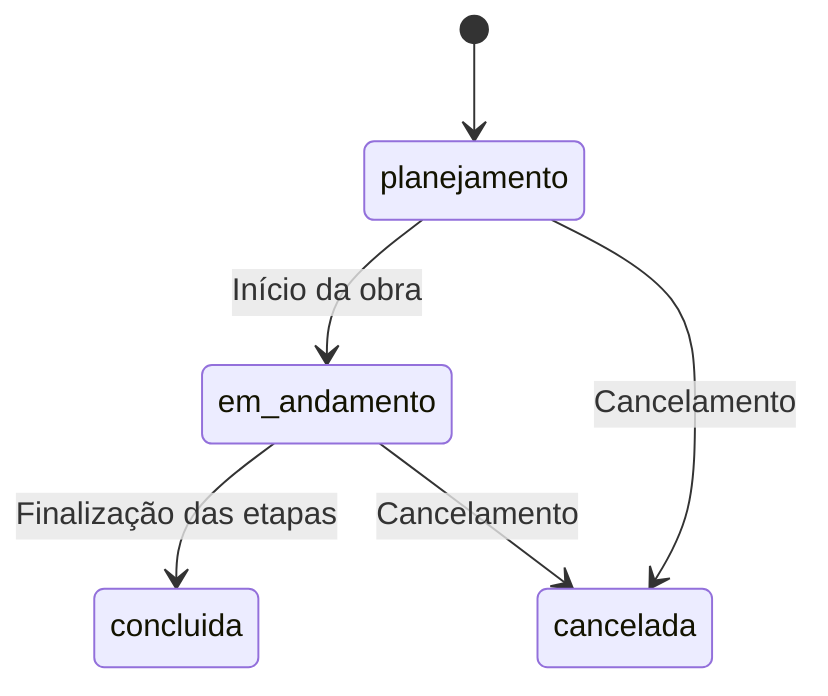
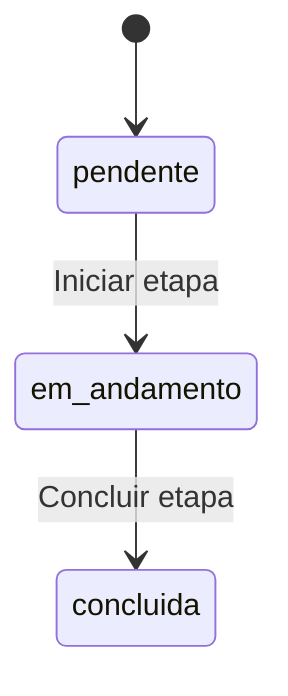
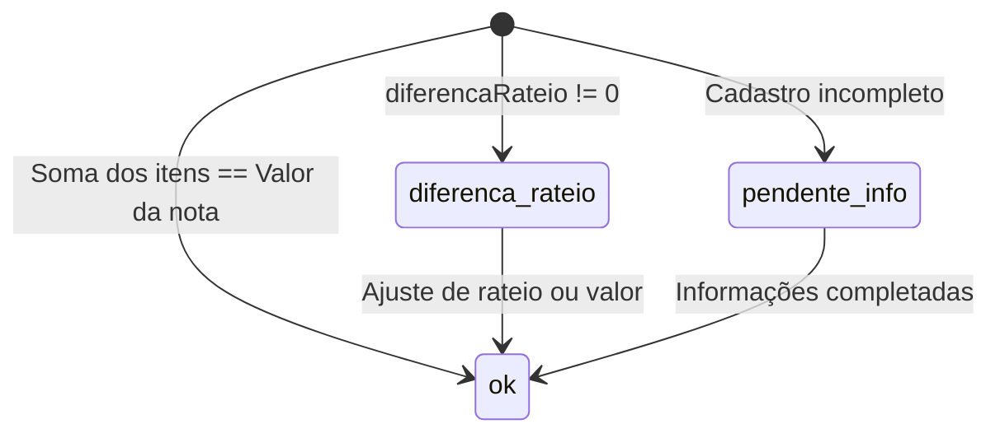
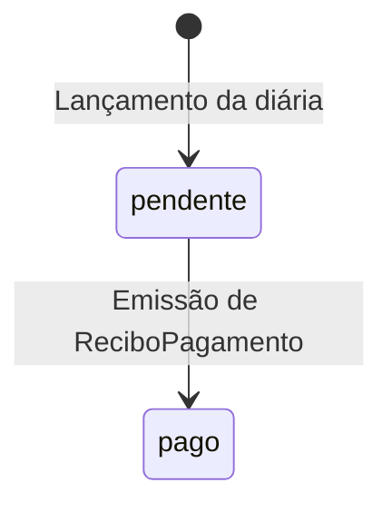
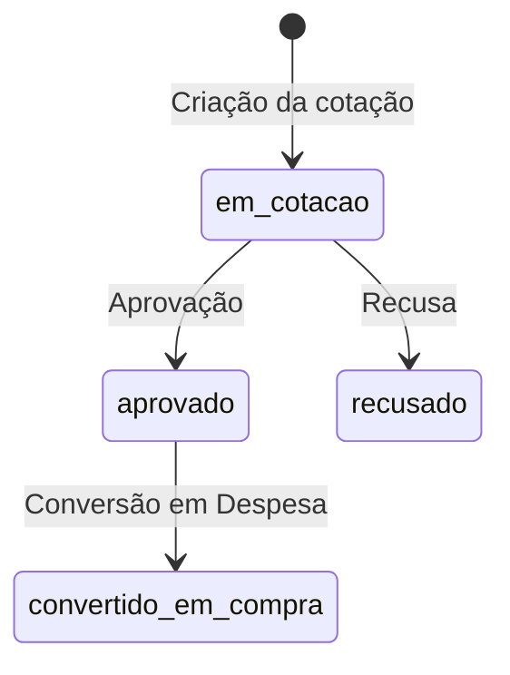
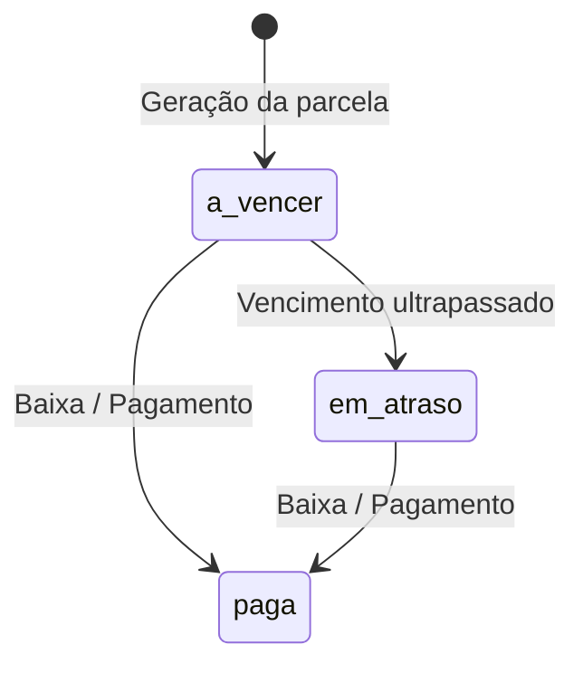
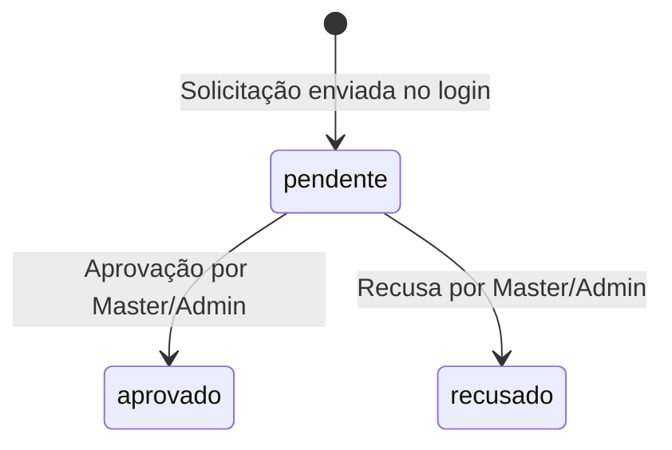

# Máquinas de Estado — SISTEMA LIBRA - OBRAS

> Gerado pelo **Detective** em 2026-11-13

---

## 1. `Obra.status`

Valores: `planejamento`, `em_andamento`, `andamento` (legado/sinônimo), `concluida`, `cancelada`. 🟢 CONFIRMADO

---

## 2. `Etapa.status`

Valores: `pendente`, `em_andamento`, `concluida`. 🟢 CONFIRMADO

---

## 3. `Despesa.statusConferencia`

Valores: `ok`, `pendente_info`, `diferenca_rateio`. 🟢 CONFIRMADO

---

## 4. `Diaria.statusPagamento`

Valores: `pendente`, `pago`. 🟢 CONFIRMADO

---

## 5. `Orcamento.status`

Valores: `em_cotacao`, `aprovado`, `recusado`, `convertido_em_compra`. 🟢 CONFIRMADO

---

## 6. `Parcela.status`

Valores: `a_vencer`, `paga`, `em_atraso`. 🟢 CONFIRMADO

---

## 7. `SolicitacaoAcesso.status`

Valores: `pendente`, `aprovado`, `recusado`. 🟢 CONFIRMADO

