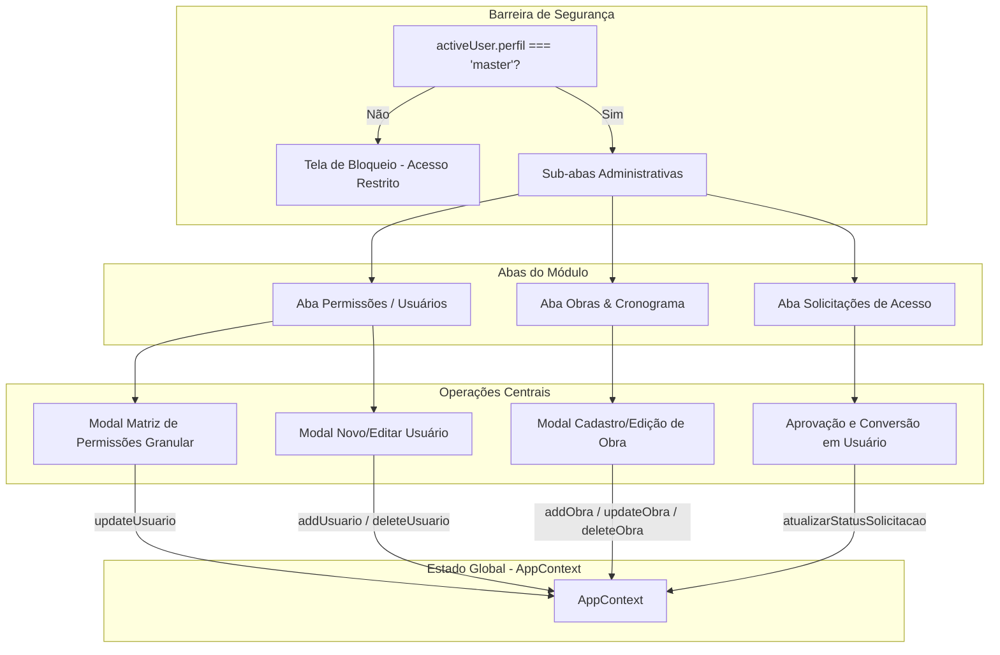

# Design — Módulo `usuarios`

> Especificação arquitetural, modelos de dados, controle de permissões e fluxos de segurança do módulo de usuários e obras.
> Documento gerado automaticamente pelo **Reversa Writer**.

---

## 1. Visão Arquitetural

O módulo `usuarios` é o núcleo administrativo do sistema. Ele governa quem pode acessar a aplicação, quais dados pertencem a qual obra e quais ações cada usuário tem permissão para disparar em cada módulo funcional.



---

## 2. Modelos de Dados Centrais

### 2.1 Usuário e Matriz de Permissões
```typescript
type PerfilUsuario = 'master' | 'admin' | 'operador';

interface PermissaoModulo {
  visualizar: boolean;
  criar: boolean;
  editar: boolean;
  excluir: boolean;
}

interface Usuario {
  id: string;
  nome: string;
  email: string;
  perfil: PerfilUsuario;
  avatarColor: string;
  ativo: boolean;
  dataCadastro: string;
  permissoes: {
    dashboard: PermissaoModulo;
    despesas: PermissaoModulo;
    materiais: PermissaoModulo;
    maoDeObra: PermissaoModulo;
    recibos: PermissaoModulo;
    orcamentos: PermissaoModulo;
    producao: PermissaoModulo;
    cartoes: PermissaoModulo;
    usuarios: PermissaoModulo;
    relatorios: PermissaoModulo;
  };
}
```

### 2.2 Obra e Cronograma
```typescript
interface Obra {
  id: string;
  nome: string;
  endereco: string;
  dataInicio: string;
  orcamentoTotal: number;
  tetoMaoDeObra: number;
  etapaAtualId: string;
  etapaAtual?: string;
  valorVenda?: number;
  status: 'em_andamento' | 'planejamento' | 'concluida' | 'cancelada' | 'andamento';
}

const ETAPAS_CRONOGRAMA = [
  { numero: 1, nome: 'Sapata' },
  { numero: 2, nome: 'Alvenaria' },
  { numero: 3, nome: 'Laje' },
  { numero: 4, nome: 'Hidráulico' },
  { numero: 5, nome: 'Elétrico' },
  { numero: 6, nome: 'Reboco' },
  { numero: 7, nome: 'Piso' },
  { numero: 8, nome: 'Cerâmica' },
  { numero: 9, nome: 'Gesso' },
  { numero: 10, nome: 'Pintura' },
  { numero: 11, nome: 'Acabamento' },
];
```

---

## 3. Matriz Padrão de Perfis de Acesso

1. **Master:** Acesso irrestrito a todos os módulos, com permissão total (`visualizar: true, criar: true, editar: true, excluir: true`). É o único perfil autorizado a entrar na tela de Permissões e gerenciar outras contas.
2. **Admin:** Visualização ampla de todos os módulos. Capacidade de criação e edição operacional, exceto no módulo de `usuarios`. Restrição de exclusão em `cartoes` e `usuarios`.
3. **Operador:** Acesso focado no canteiro de obras (lançar despesas, diárias, materiais, produção). Sem permissão para excluir registros e sem acesso ao módulo de usuários.

